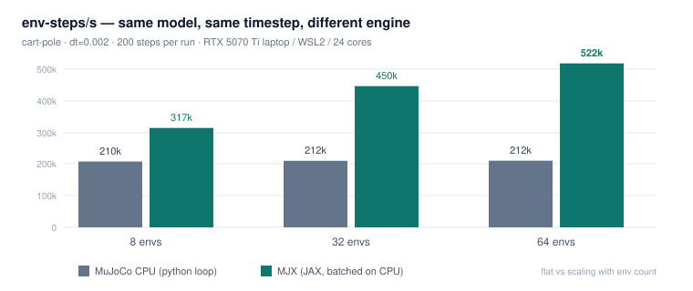

# sim-throughput-benchmark

**同一任务，不同引擎：多少 env-steps/s，以及在给定精度下最快能跑多快。**
*How many env-steps per second does each simulator deliver — and at what accuracy?*

两个只回答两个问题的脚本：

| 脚本 | 回答的问题 | 输出 |
| --- | --- | --- |
| `bench/harness.py` | 每个引擎每秒能跑多少环境步？ | `env-steps/s` / `steps/s` / `spread` |
| `bench/accuracy.py` | 时间步放大到多少，误差还能接受？ | `dt × steps/s × RMSE`（精度-速度前沿） |

```
bench/
├── harness.py                 # 统一扫描（Backend.step(n) 一行契约）
├── accuracy.py                # dt 扫描 + 相对参考解的 RMSE + Pareto 表
└── backends/
    ├── dummy.py               # ✅ 自测后端（Python 控制流开销下限）
    ├── mujoco_cpu.py          # ✅ MuJoCo CPU 基线（内联 cart-pole，无外部资产）
    ├── mjx.py                 # ⬜ MuJoCo MJX（JAX，GPU 批量）
    ├── gazebo.py              # ⬜ Gazebo（ROS 2，CPU）
    └── isaac_lab.py           # ⬜ Isaac Lab（PhysX 5，GPU）
```

## 快速开始

```bash
pip install mujoco                       # 只有 CPU 基线需要它

python bench/harness.py --backend mujoco_cpu --envs 8,32,64 --steps 200 --repeat 3
python bench/accuracy.py --duration 1.0  # dt 1e-3..1e-2，参考解 dt=1e-4
```

输出（示例格式，数字取决于你的机器）：

```
| backend    |   envs |  steps |   wall_s |   env-steps/s |   steps/s |  spread |
| mujoco_cpu |      8 |    200 |    0.008 |       xxx,xxx |   xxx,x.x |    0.1% |
| mujoco_cpu |     32 |    200 |    0.033 |       xxx,xxx |   xxx,x.x |    0.4% |
```

```
| dt   | steps/s | RMSE slider (mm) | RMSE hinge (rad) | speedup vs ref |
| 0.001| xxx,xxx |            0.xxx |           0.xxx x |           x.x× |
| 0.01 |  xx,xxx |             x.xxx |           0.xxx x |          xx.x× |
```

## 指标口径（写论文/汇报都按这个）

| 指标 | 定义 | 为什么需要它 |
| --- | --- | --- |
| `env_steps_per_s` | `envs × steps / wall_s` | 唯一能跨模型比较的吞吐口径 |
| `steps_per_s` | `steps / wall_s` | 暴露单步调度开销 |
| `spread_pct` | `(median − best) / best` | **>20% 不算测量，算命**（热降频/其他进程） |
| `RMSE (mm)` | 相对 `dt=1e-4` 参考解的状态误差 | 精度必须对着参考解，不是对着自己 |
| `speedup_vs_ref` | 参考解耗时 / 本次耗时 | 精度-速度权衡的斜率 |

## 精度-速度前沿（要填的表）

题目不是"跑得快不快"，而是**"误差 1 mm 以内最快能跑多快"**。

| dt | steps/s | RMSE slider (mm) | 满足 ≤1 mm | 备注 |
| --- | --- | --- | --- | --- |
| 0.001 | _待填_ | _待填_ | ✅/❌ | |
| 0.002 | _待填_ | _待填_ | ✅/❌ | |
| 0.005 | _待填_ | _待填_ | ✅/❌ | |
| 0.01 | _待填_ | _待填_ | ✅/❌ | |

## 实测 / Measured

环境：RTX 5070 Ti Laptop 12 GB · WSL2 Ubuntu 24.04 · 24 核 · mujoco 4.0.1 · jax (CPU build)



| backend | envs | env-steps/s | steps/s | spread |
| --- | --- | --- | --- | --- |
| mujoco_cpu | 8 | 209,642 | 26,205 | 0.3% |
| mujoco_cpu | 32 | 212,040 | 6,626 | 1.5% |
| mujoco_cpu | 64 | 212,403 | 3,319 | 0.4% |
| mjx (cpu) | 8 | 316,572 | 39,572 | 1.9% |
| mjx (cpu) | 32 | 449,696 | 14,053 | 1.9% |
| mjx (cpu) | 64 | **522,129** | 8,158 | 2.1% |

两个读数值得说：

1. **`mujoco_cpu` 的吞吐跟 env 数几乎无关**（209k → 212k）：它是 Python 循环逐个环境步进，加环境只是加循环次数，不会变快。
2. **`mjx` 在 CPU 上反而更快，而且 env 越多差距越大**（1.5× → 2.5×）：一次 batched 调用摊掉了大部分派发开销。
   所以"上 GPU 才快"是个未经检验的假设——先把 CPU 基线测出来，才知道 GPU 那几十倍里有多少是真算力。

> GPU（`--device cuda`）的数字待补：本机 jax CUDA wheel 体积大、下载未完成，代码路径已用 CPU 跑通。

## 状态

- [x] 统一 Backend 契约 + dummy 后端（自测）
- [x] MuJoCo CPU 基线（内联 cart-pole，无外部依赖）
- [x] 精度扫描：dt → RMSE vs 参考解 → Pareto 表
- [x] CI：装 mujoco，跑 harness + accuracy（无 GPU 也能绿）
- [ ] MJX（JAX/CUDA）后端
- [ ] Isaac Lab（PhysX 5）后端
- [ ] Gazebo（CPU）后端
- [ ] 拐点分析：env 数 × device 的瓶颈归因

> **数据口径**：README 里的数字只从 `results/*.csv` 生成，不手填；
> 每次跑都记录硬件、驱动、版本（`--out` 会写时间戳）。

## License

MIT

## 相关 / Related

- [robot-sim-benchmarks](https://github.com/cccjj55/robot-sim-benchmarks) — published throughput and training-time claims from other projects, with hardware, version and an evidence label.本文的数字也在那张表里（`MEASURED` 行）。
